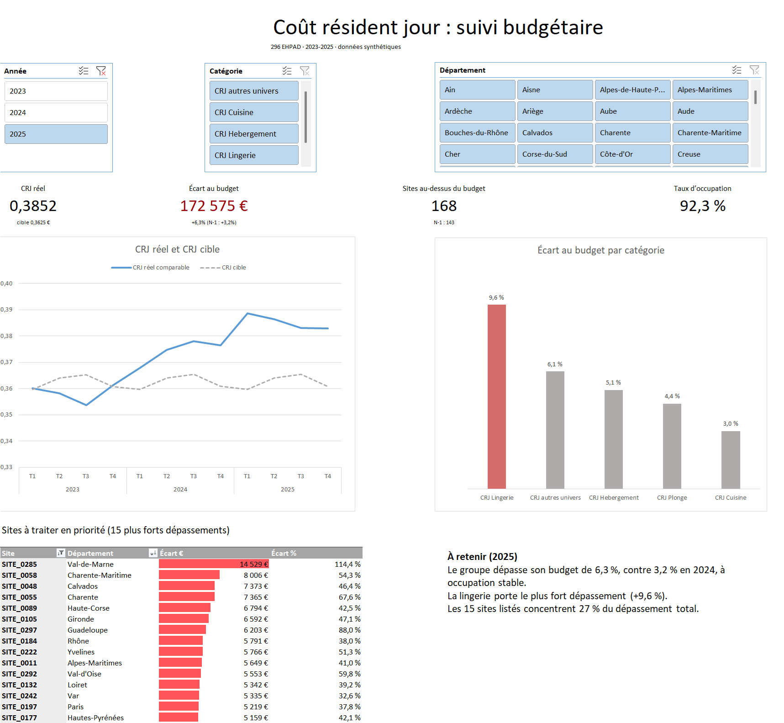
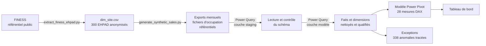
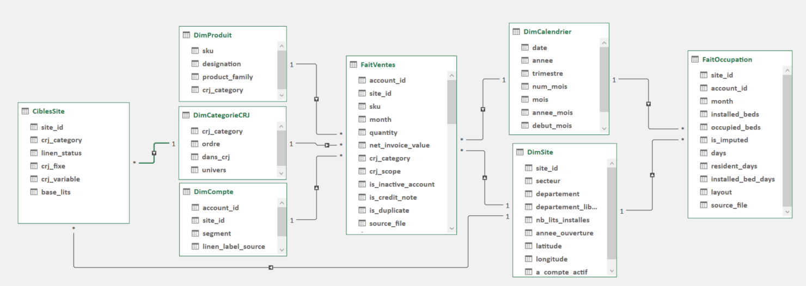

# Coût résident jour (CRJ) : industrialiser un suivi budgétaire multi-sites

> Suivi trimestriel du coût des produits d'hygiène et de lingerie de 296 EHPAD face à leur budget.
> Un processus Excel manuel (RECHERCHEV, copier-coller) transformé en pipeline Power Query + modèle Power Pivot :
> **production trimestrielle ramenée de 15 jours à 2 jours**, anomalies tracées au lieu d'être masquées.



---

## Le problème métier

Un fournisseur de produits d'hygiène et de lingerie facture un groupe national d'environ 300 EHPAD.
Le contrat fixe, par catégorie de produits, un **coût résident jour (CRJ) cible** : ce que le groupe accepte de dépenser par lit et par jour.
Chaque trimestre, il faut répondre à trois questions :

1. Le groupe dépense-t-il plus que son budget ?
2. Dans quelles catégories de produits ?
3. Quels sites traiter en priorité ?

À mon arrivée, le fichier de suivi demandait **15 jours de travail par trimestre** : extractions copiées-collées, RECHERCHEV en cascade, formules à tirer à la main. Résultat : des erreurs de formules mal étendues, des collages décalés, et des chiffres difficiles à défendre devant le client.

## Ce que j'ai fait

| Avant | Après |
|---|---|
| Fichiers sources recopiés à la main | Ingestion automatique d'un dossier : ajouter un mois = déposer un fichier |
| RECHERCHEV entre onglets | Modèle en étoile Power Pivot, relations entre tables |
| ~40 mesures copiées-collées (CRJ1…CRJ5, BUDGET1…5) | 28 mesures DAX, chacune définie une fois |
| Erreurs remplacées par des vides | Table `Exceptions` : chaque anomalie listée avec sa gravité et l'action attendue |
| Documentation absente | Mode opératoire, dictionnaire de données, journal des décisions |

**Impact** : production ramenée de **15 jours à 2 jours** par trimestre (−87 %, soit environ 52 jours de travail récupérés par an), et zéro retouche manuelle après actualisation.

> **Confidentialité.** Les données de la mission ne peuvent pas être publiées. Ce dépôt reconstitue le projet de bout en bout sur des données réalistes :
> les **sites sont de vrais EHPAD** issus du référentiel public FINESS (anonymisés), les **ventes et l'occupation sont synthétiques**, générées avec la structure et les défauts rencontrés pendant la mission. Aucune valeur réelle (prix, volume, cible) n'est reprise.

## Ce que montrent les données (2025)

- Le groupe dépasse son budget de **+6,3 %** (+172 575 €), contre −1,1 % en 2023 et +3,2 % en 2024.
- Le taux d'occupation est **stable à 92,3 %** : la dérive ne vient pas de l'activité, mais de la hausse des prix face à des cibles inchangées.
- La **lingerie** porte le plus fort dépassement (+9,6 %).
- **168 sites sur 296** dépassent leur budget ; les 15 premiers concentrent 27 % du dépassement total.

La question qui en découle pour le métier : renégocier les prix, réviser les cibles, ou agir sur la consommation des sites qui dérapent ?

## Architecture





Deux tables de faits partagent les mêmes dimensions de site et de calendrier :
`FaitVentes` porte le numérateur du CRJ (le chiffre d'affaires), `FaitOccupation` le dénominateur (les résidents-jours).
Un filtre sur un site ou une période s'applique donc aux deux à la fois.

## Choix techniques notables

Chaque choix est documenté, avec les options écartées, dans le [journal des décisions](docs/decision_log.md).

- **Aucune ligne supprimée en silence.** Doublons, avoirs, comptes inactifs : signalés par des indicateurs, jamais retirés. Le total du modèle rapproche toujours les exports (D-010).
- **Un fichier dont la mise en page change chaque trimestre** est lu sans intervention : la ligne d'en-tête est recherchée, trois mises en page sont reconnues, une mise en page inconnue arrête l'actualisation avec un message clair.
- **Le CRJ se calcule par site**, pas par compte : un site peut avoir deux numéros de compte, ses lits ne comptent qu'une fois (D-012).
- **La règle de budget est portée par les données.** Base de lits installés ou occupés selon la catégorie, stockée dans le fichier des cibles : changer la règle = modifier une cellule, pas le DAX (D-014).
- **On ne compare que ce qui est comparable.** La lingerie des sites sans statut de linge sort de la comparaison avec la cible, ventes comprises (D-015).
- **Résultats vérifiés indépendamment.** Chaque chiffre du modèle a été recalculé en Python avant d'être validé.

## Reproduire le projet

Prérequis : Excel 365 (Power Query, Power Pivot), Python 3.10+.

```powershell
python -m venv .venv
.venv\Scripts\Activate.ps1
pip install -r requirements.txt
python src/generate_synthetic_sales.py --seed 42
```

Puis ouvrir `excel/CRJ_modele.xlsx`, renseigner le chemin du dépôt dans le paramètre Power Query `RacineProjet` (le seul chemin du projet), et lancer **Données → Actualiser tout**.

Le détail, avec les valeurs de contrôle attendues, est dans le [mode opératoire](docs/runbook.md).
Pour reconstruire la dimension des sites depuis FINESS, voir la section 2 du mode opératoire.

## Structure du dépôt

```
├── src/                 scripts Python : extraction FINESS, générateur de données
├── powerquery/          une requête Power Query = un fichier .pq (versionnable, relisible)
├── model/               mesures DAX commentées
├── excel/               classeur : modèle Power Pivot et tableau de bord
├── data/reference/      dimension des sites, rapport qualité FINESS, mention de source
├── data/synthetic/      exports de ventes, fichiers d'occupation, référentiels, vérité terrain
├── docs/                mode opératoire, dictionnaire de données, journal des décisions
└── tests/               contrôle statique des références entre requêtes
```

## Limites et suites

- Les lits des unités d'hébergement renforcées (UHR) sont exclus en attendant de confirmer leur traitement dans FINESS (D-004).
- Version Power BI (format `.pbip`, modèle lisible dans Git) : prochaine étape.
- Prévision du CRJ de fin d'année face à la cible : projet de machine learning à venir dans ce portfolio.

## Sources et licence

- Sites : FINESS+ (Agence du Numérique en Santé), via l'outil [referentiels-sante](https://github.com/Irreductix/referentiels-sante), sous Licence Ouverte 2.0. Voir [`data/reference/MENTION-SOURCE.txt`](data/reference/MENTION-SOURCE.txt).
- Ventes, occupation et cibles : données synthétiques générées par ce dépôt.

---

**Arnaud Kamguia**, Data Analyst · [LinkedIn](https://www.linkedin.com/in/À-COMPLÉTER)
